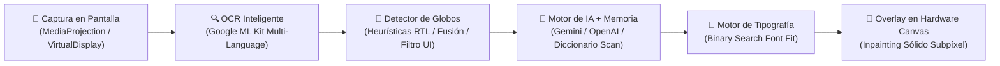
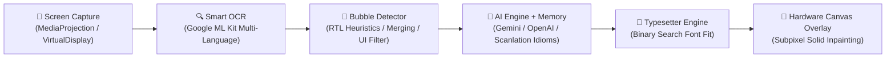

  

  # ⚡ Manhwa AI Translator
  ### Traductor en Tiempo Real con IA para Cómics, Manhwas, Mangas, Novelas Web y Apps
  ### Real-Time On-Screen AI Translator for Comics, Manhwas, Mangas, Web Novels & Apps

  **Nivel Scanlation Profesional en Pantalla · Inpainting Inteligente · Tipografías de Cómic**  
  **Professional Scanlation Quality · Smart Inpainting · Authentic Comic Typography**

  

    <a href="#-versión-en-español"><b>🇪🇸 Versión en Español</b></a>
    &nbsp;•&nbsp;
    <a href="#-english-version"><b>🇬🇧 English Version</b></a>
  

  

    
    
    
    
  

  

    
    
    
    
    
    
  

  

    <a href="https://github.com/DarkYTGG/ManhwaTranslator-App/releases/latest/download/ManhwaTranslator.apk">
      <b>📥 Descargar APK Directa / Download APK</b>
    </a>
  

---

## 🇪🇸 Versión en Español

### 🌟 ¿Qué es Manhwa AI Translator?

**Manhwa AI Translator** es una aplicación nativa para Android diseñada específicamente para lectores exigentes de cómics coreanos (*Manhwas/Webtoons*), japoneses (*Mangas*), chinos (*Manhuas*), novelas ligeras en inglés, videojuegos y aplicaciones móviles.

A diferencia de las herramientas genéricas que colocan cuadros toscos de texto que arruinan el dibujo, Manhwa AI Translator funciona como un **asistente de Scanlation automatizado en tiempo real**:
- **Detecta con precisión** los globos de diálogo individuales en pantalla.
- **Aplica inpainting limpio**, borrando el texto original con el color exacto del fondo de la viñeta.
- **Tipografía real de cómic**, calculando matemáticamente el tamaño y corte de línea para que las letras encajen dentro del globo de forma estética y natural.
- **Traducción contextual con IA**, preservando modismos y respetando honoríficos propios de la cultura oriental (*Hyung, Oppa, Senpai, Shifu*).

> [!NOTE]
> **Transparencia y Desarrollo Activo:**  
> La aplicación se encuentra en constante evolución técnica. Actualmente trabajamos en optimizaciones continuas para perfeccionar la separación automática en casos de globos dobles conectados siameses y en calibrar con mayor finura la memoria contextual en secuencias de diálogo rápido.

---

### 📊 Comparativa vs Otros Traductores

| Característica | ⚡ Manhwa AI Translator | 🔍 Google Lens | 📱 Traductores Genéricos |
| :--- | :---: | :---: | :---: |
| **Inpainting Limpio (Sin recuadros feos)** | ✅ **100% Sólido Subpíxel** | ❌ Borroso / Parche gris | ❌ Cajas opacas con bordes |
| **Tipografía Real de Cómic (`Comic Neue`, `Bangers`)** | ✅ **Nivel Editorial** | ❌ Fuente genérica del sistema | ❌ Arial / Roboto plana |
| **Ajuste Dinámico de Burbuja (Binary Search)** | ⚡ **Ajuste Automático** *(Optimizando globos dobles)* | ❌ Desbordes frecuentes | ❌ Texto cortado o diminuto |
| **Comprensión Contextual y Memoria de Escena** | ⚡ **IA Multimodal** *(Calibración continua)* | ❌ Traducción aislada palabra a palabra | ❌ Literal sin coherencia |
| **Lectura Manga Derecha a Izquierda (RTL) y Vertical** | ✅ **Soporte Completo** | ❌ Solo lectura occidental | ⚠️ Fallos frecuentes |
| **Glosario Personalizado (Nombres y Términos)** | ✅ **Totalmente Editable** | ❌ No disponible | ❌ No disponible |
| **Navegador Web Integrado con AdBlock** | ✅ **Incluido** | ❌ No | ❌ No |
| **Flexibilidad de Motores de IA (BYOK)** | ✅ **Multi-Proveedor** *(Gemini, GPT, DeepSeek, Local)* | ⚠️ Ecosistema cerrado de Google | 💳 Planes rígidos o anuncios invasivos |
| **Actualizaciones Automáticas Integradas (OTA)** | ✅ **En 1 clic desde la App** | ⚠️ Requiere Play Store | ❌ Descargas manuales |

---

### ✨ Características Principales
- 🔮 **Modo Universal Inteligente:** Clasifica automáticamente entre globo elíptico, impacto/onomatopeya, novela continua o tarjeta de interfaz.
- 🎨 **Tipografías Profesionales:** `Comic Neue Bold`, `Bangers Regular`, `Comic Neue Italic` y `Prose Sans`.
- 🧼 **Inpainting Sólido:** Muestreo de color inteligente que reemplaza la tinta original sin recortar las viñetas.
- 🌐 **Navegador Web con AdBlocker:** Lee en tus sitios favoritos bloqueando publicidad invasiva y con lector de capítulos en cascada.
- 🤖 **Arquitectura Multi-IA:** Conecta tu clave de Google Gemini, OpenAI (GPT-4o), DeepSeek o ejecuta servidores locales con Ollama.

---

### 🛠️ Arquitectura Técnica y Flujo de Procesamiento

---

### 🌍 Idiomas y Dialectos Soportados

| Idioma Original | Idioma de Destino | Modos Soportados |
| :--- | :--- | :--- |
| **Coreano (한국어)** | Español Latino / Castellano | Manhwas, Webtoons, Diálogos y Novelas |
| **Japonés (日本語)** | Español Latino / Castellano | Mangas (Lectura Horizontal y Vertical RTL) |
| **Chino (中文)** | Español Latino / Castellano | Manhuas, Webnovels (Xianxia/Wuxia) y Juegos |
| **Inglés (English)** | Español Latino / Castellano | Webtoons occidentales, Novelas Web y Apps |
| **Automático (Auto)** | Español Latino / Castellano | Detección inteligente por análisis Unicode |

---

### 📲 Instalación y Configuración
1. Descarga el archivo **`ManhwaTranslator.apk`** desde [Releases](https://github.com/DarkYTGG/ManhwaTranslator-App/releases).
2. Instálalo en tu dispositivo Android y concede los permisos de **Superposición sobre otras apps** y **Captura de pantalla**.
3. En **Ajustes** ➔ **Motor de IA**, ingresa tu clave gratuita de [Google AI Studio](https://aistudio.google.com/) o de tu proveedor preferido.
4. Pulsa **Iniciar Servicio** y traduce en 1 toque con el botón flotante sobre cualquier app.

---

## 🇬🇧 English Version

### 🌟 What is Manhwa AI Translator?

**Manhwa AI Translator** is a native Android application engineered specifically for passionate readers of Korean webtoons (*Manhwas*), Japanese comics (*Mangas*), Chinese comics (*Manhuas*), light novels, and mobile gaming interfaces in real time.

Unlike generic translators that overlay bulky solid blocks that ruin the artwork, Manhwa AI Translator acts as an **automated on-device scanlation assistant**:
- **Accurately identifies** individual speech bubbles directly from the screen.
- **Applies clean subpixel inpainting**, erasing the raw original text with the exact sampled background palette of the frame.
- **Authentic comic typography**, mathematically computing font size and line breaks via binary search to fill the contour naturally.
- **Context-aware AI translation**, preserving character gender consistency, idioms, and cultural honorifics (*Hyung, Oppa, Senpai, Shifu*).

> [!NOTE]
> **Transparency & Active Development:**  
> The application is continuously evolving. We are actively refining edge cases in separating Siamese connected double bubbles and fine-tuning contextual memory during extended fast-paced dialogue exchanges.

---

### 📊 Comparison vs Other Translators

| Feature | ⚡ Manhwa AI Translator | 🔍 Google Lens | 📱 Generic Translators |
| :--- | :---: | :---: | :---: |
| **Clean Inpainting (No ugly rectangular boxes)** | ✅ **100% Solid Subpixel** | ❌ Blurry / Gray patch | ❌ Opaque bordered boxes |
| **Authentic Comic Fonts (`Comic Neue`, `Bangers`)** | ✅ **Editorial Quality** | ❌ Generic system font | ❌ Flat Arial / Roboto |
| **Dynamic Bubble Sizing (Binary Search)** | ⚡ **Automated Fit** *(Refining double bubbles)* | ❌ Frequent text overflows | ❌ Clipped or tiny font |
| **Contextual Scene Memory** | ⚡ **Multimodal AI** *(Ongoing calibration)* | ❌ Isolated word-by-word | ❌ Incoherent literal outputs |
| **Manga Right-to-Left (RTL) & Vertical Text** | ✅ **Full Support** | ❌ Western LTR only | ⚠️ Frequent parsing failures |
| **Custom Glossary (Characters & Lore)** | ✅ **Fully Editable** | ❌ Not available | ❌ Not available |
| **Integrated Web Browser with AdBlock** | ✅ **Included** | ❌ No | ❌ No |
| **AI Model Flexibility (Bring Your Own Key)** | ✅ **Multi-Provider** *(Gemini, GPT, DeepSeek, Local)* | ⚠️ Google locked ecosystem | 💳 Rigid subscriptions / Intrusive ads |
| **Built-in In-App Updates (OTA)** | ✅ **1-Click from Settings** | ⚠️ Play Store required | ❌ Manual GitHub checking |

---

### ✨ Core Features
- 🔮 **Smart Universal Mode:** Automatically switches between elliptical comic bubbles, scream/impact onomatopoeias, reading prose, or game UI cards.
- 🎨 **Scanlation-Grade Typography:** `Comic Neue Bold`, `Bangers Regular`, `Comic Neue Italic`, and `Prose Sans`.
- 🧼 **Solid Inpainting:** Subpixel color sampling covering the raw source text without degrading bordering line art.
- 🌐 **Integrated Browser with AdBlocker:** Read comfortably on aggregators with popup blocking and full chapter cascaded translation.
- 🤖 **Multi-AI Architecture:** Connect your Google Gemini, OpenAI (GPT-4o), DeepSeek API key, or run offline/local models with Ollama.

---

### 🛠️ Technical Architecture & Pipeline

---

### 🌍 Supported Languages

| Source Language | Target Language | Supported Formats |
| :--- | :--- | :--- |
| **Korean (한국어)** | Spanish (Latin America / Spain) | Manhwas, Webtoons, Dialogues & Web Novels |
| **Japanese (日本語)** | Spanish (Latin America / Spain) | Mangas (Horizontal & Vertical RTL Reading) |
| **Chinese (中文)** | Spanish (Latin America / Spain) | Manhuas, Webnovels (Xianxia/Wuxia) & Games |
| **English** | Spanish (Latin America / Spain) | Western Webtoons, Novels & Mobile Apps |
| **Automatic (Auto)** | Spanish (Latin America / Spain) | Unicode distribution analysis |

---

### 📲 Installation & Quick Setup
1. Download **`ManhwaTranslator.apk`** from [Releases](https://github.com/DarkYTGG/ManhwaTranslator-App/releases).
2. Install it on your Android device and grant **Display over other apps** and **Screen Capture** permissions.
3. In **Settings** ➔ **AI Engine**, paste your free API key from [Google AI Studio](https://aistudio.google.com/) or your preferred LLM provider.
4. Tap **Start Service** and use the floating pill button to translate anything on screen with a single tap.

---

## 🌐 Más Proyectos Destacados / More Featured Projects

| Proyecto / Project | Tipo / Type | Descripción / Description | Enlace / Link |
| :--- | :---: | :--- | :---: |
| 💼 **Sistema de Nómina (CaroníPay)** | 🚀 Producción / Production | Plataforma empresarial activa de liquidación contable, geocercas GPS y normativa laboral. / Active enterprise platform for payroll, GPS geofencing, and labor compliance. | [**Ver / View ➔**](https://github.com/DarkYTGG/Sistema-de-Nomina) |
| 🐓 **RoosterGenics Plugin** | 🎮 Servidores / Servers | Plugin avanzado para Minecraft (Paper / Purpur / Folia 1.21) con arquitectura multihilo Folia-Aware. / Advanced Minecraft Folia-Aware plugin. | [**Ver / View ➔**](https://github.com/DarkYTGG/RoosterGenics-Plugin) |
| 🐓 **Wiki RoosterGenics** | 📖 Docs / Web | Enciclopedia y documentación técnica para Minecraft 1.21 en GitHub Pages. / Official documentation wiki on GitHub Pages. | [**Ver / View ➔**](https://github.com/DarkYTGG/Wiki-RoosterGenics) |
| ⚡ **IA de Respaldo** | 🎓 Académico / Academic | Chatbot de ingeniería eléctrica para subestaciones y respaldo 125 VDC con Gemini. / Electrical engineering AI assistant. | [**Ver / View ➔**](https://github.com/DarkYTGG/IA-de-respaldo) |
| 🎮 **PixelVault** | 🎓 Académico / Academic | Plataforma e-commerce y catálogo digital para videojuegos en Python y Flask. / Digital videogame catalog and e-commerce platform. | [**Ver / View ➔**](https://github.com/DarkYTGG/Tienda-de-Videojuegos) |

  👉 <b>Explora todos mis repositorios en / Explore all repositories at:</b> <a href="https://github.com/DarkYTGG"><b>github.com/DarkYTGG</b></a>

---

## 💻 Stack Tecnológico / Tech Stack

- **Lenguaje / Language:** [Kotlin 2.0](https://kotlinlang.org/) (Coroutines, StateFlow, Serialization)
- **Framework UI:** [Jetpack Compose](https://developer.android.com/jetpack/compose) + Material 3
- **Visión / Vision:** Google ML Kit Text Recognition (Latin, Korean, Japanese, Chinese)
- **Overlay Rendering:** Android `WindowManager` hardware accelerated canvas
- **Networking:** [OkHttp 4](https://square.github.io/okhttp/) & JSON Serialization
- **Local Storage:** Jetpack DataStore Preferences
- **CI / CD:** GitHub Actions automated release pipeline

---

## 🤝 Contribuir y Soporte / Contributing & Support

- 🐛 **Bugs:** Abre un reporte en [Issues](https://github.com/DarkYTGG/ManhwaTranslator-App/issues).
- ⭐ **Soporte / Support:** Si te resulta útil el proyecto, ¡apóyalo con una estrella en GitHub! / *If you find this project useful, give it a star on GitHub!*

---

  
Creado con dedicación por / Built with dedication by <b><a href="https://github.com/DarkYTGG">@DarkYTGG</a></b>.

  Distribuido bajo Licencia MIT. © 2026 DarkYTGG.

