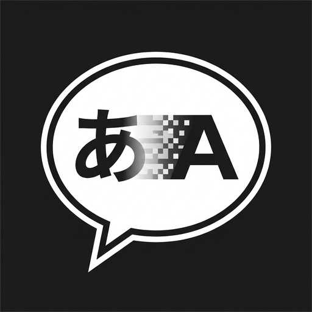
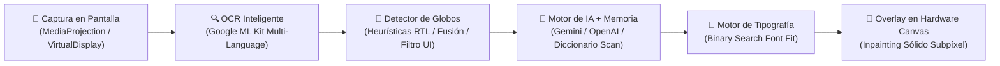

  

  # ⚡ Manhwa AI Translator
  ### Traductor en Tiempo Real con IA para Cómics, Manhwas, Mangas, Novelas Web y Apps

  **Nivel Scanlation Profesional en tu Pantalla · Inpainting Inteligente · Tipografías de Cómic**

  

    
    
    
    
  

  

    
    
    
    
    
    
  

  

    <a href="https://github.com/DarkYTGG/ManhwaTranslator-App/releases/latest/download/ManhwaTranslator.apk">
      <b>📥 Descargar APK Directa (Gratis)</b>
    </a>
    •
    <a href="#caracteristicas">✨ Características</a>
    •
    <a href="#comparativa">📊 Comparativa</a>
    •
    <a href="#instalacion">🚀 Instalación</a>
    •
    <a href="#otros-proyectos">🌟 Otros Proyectos</a>
  

---

## 📖 Tabla de Contenidos

1. [🌟 ¿Qué es Manhwa AI Translator?](#que-es)
2. [📊 Comparativa: Manhwa AI Translator vs. Traductores Convencionales](#comparativa)
3. [✨ Características Principales](#caracteristicas)
4. [🛠️ Arquitectura Técnica y Flujo de Procesamiento](#arquitectura)
5. [🌍 Idiomas y Dialectos Soportados](#idiomas)
6. [📲 Instalación y Primeros Pasos](#instalacion)
7. [🔑 Configurar tu Clave Gratuita de Google Gemini](#configuracion-gemini)
8. [🌐 Más Proyectos Destacados de @DarkYTGG](#otros-proyectos)
9. [💻 Tecnologías y Stack Utilizado](#tecnologias)
10. [🤝 Contribuir y Soporte](#soporte)

---

## 🌟 ¿Qué es Manhwa AI Translator?

**Manhwa AI Translator** es una aplicación nativa para Android diseñada específicamente para lectores exigentes de cómics coreanos (*Manhwas/Webtoons*), japoneses (*Mangas*), chinos (*Manhuas*), novelas ligeras en inglés, videojuegos y aplicaciones móviles.

A diferencia de las herramientas genéricas que colocan cuadros toscos de texto que arruinan el dibujo, Manhwa AI Translator funciona como un **asistente de Scanlation automatizado en tiempo real**:

- **Detecta con precisión** los globos de diálogo individuales o conectados.
- **Aplica inpainting limpio**, borrando el texto original con el color exacto del fondo de la viñeta.
- **Tipografía real de cómic**, calculando matemáticamente el tamaño y corte de línea para que las letras encajen dentro del globo de forma estética y natural.
- **Traducción contextual con IA**, evitando errores de género, conservando modismos y respetando honoríficos propios de la cultura oriental (*Hyung, Oppa, Senpai, Shifu*).

---

## 📊 Comparativa vs Otros Traductores

| Característica | ⚡ Manhwa AI Translator | 🔍 Google Lens | 📱 Traductores Genéricos |
| :--- | :---: | :---: | :---: |
| **Inpainting Limpio (Sin recuadros feos)** | ✅ **100% Sólido Subpíxel** | ❌ Borroso / Parche gris | ❌ Cajas opacas con bordes |
| **Tipografía Real de Cómic (`Comic Neue`, `Bangers`)** | ✅ **Nivel Editorial** | ❌ Fuente genérica del sistema | ❌ Arial / Roboto plana |
| **Ajuste Dinámico de Burbuja (Binary Search Sizing)** | ✅ **Alineación perfecta** | ❌ Desbordes frecuentes | ❌ Texto cortado o diminuto |
| **Comprensión Contextual y Memoria de Escena** | ✅ **IA Multimodal (LLMs)** | ❌ Traducción aislada palabra a palabra | ❌ Literal sin coherencia |
| **Lectura Manga Derecha a Izquierda (RTL) y Vertical** | ✅ **Soporte Completo** | ❌ Solo lectura occidental | ⚠️ Fallos frecuentes |
| **Glosario Personalizado (Nombres y Términos)** | ✅ **Totalmente Editable** | ❌ No disponible | ❌ No disponible |
| **Navegador Web Integrado con AdBlock** | ✅ **Incluido** | ❌ No | ❌ No |
| **Traducción 100% Gratuita (Google AI Studio)** | ✅ **Gemini 1.5 Flash sin límites** | ⚠️ Requiere conexión a Google | 💳 Planes de pago o anuncios |
| **Actualizaciones Automáticas Integradas (OTA)** | ✅ **En 1 clic desde la App** | ⚠️ Requiere Play Store | ❌ Descargas manuales |

---

## ✨ Características Principales

### 🔮 1. Modo Universal Inteligente
Clasifica de manera automática el elemento visual en pantalla y ajusta el estilo de renderizado sin que tengas que tocar nada:
- **Globos de diálogo:** Centrado elíptico con tipografía `Comic Neue Bold` y márgenes proporcionales.
- **Gritos y efectos de impacto:** Fuente `Bangers Regular` en mayúsculas de alto contraste.
- **Novelas Web y textos largos:** Bloques de lectura continua optimizados para evitar fatiga visual.
- **Interfaces de juegos o apps de mensajería:** Tarjetas minimalistas con detección y descarte de elementos de UI (batería, hora, botones del sistema).

### 🎨 2. Tipografías Profesionales Integradas
Olvídate de fuentes genéricas y textos deformados. La app incluye tipografías vectoriales calibradas:
- 💬 **`Comic Neue Bold`**: Diálogos editoriales limpios y de alta legibilidad.
- 💥 **`Bangers Regular`**: Momentos de acción, gritos de combate, onomatopeyas y exclamaciones.
- 💭 **`Comic Neue Italic`**: Monólogos internos, susurros y pensamientos de personajes.
- 📖 **`Prose & Modern Sans`**: Interfaces de usuario, menús de videojuegos y párrafos descriptivos.

### 🧼 3. Inpainting Sólido y Respeto al Arte
- Muestreo cromático inteligente para replicar el fondo exacto del globo o de la viñeta.
- Cobertura total de la tinta original sin recortar los trazos del dibujo circundante.
- Soporte completo para pantallas con notch, esquinas redondeadas y barras dinámicas de Android.

### 🌐 4. Navegador Web Integrado con AdBlocker
- Lee directamente en agregadores o sitios oficiales de mangas y manhwas.
- **AdBlocker Nativo:** Bloquea ventanas emergentes, scripts de redirección y publicidad invasiva.
- **Traductor de Capítulos en Cascada:** Descarga y traduce capítulos completos página a página para leer fluidamente sin pausas.

### 🤖 5. Arquitectura Multi-Motor de IA Flexible
Elige el motor de IA que prefieras según tu velocidad de conexión o preferencia:
- **Google Gemini (1.5 Flash / 1.5 Pro):** Ultra veloz, compresión de contexto superior y **100% gratuito** mediante tu API de Google AI Studio.
- **OpenAI (GPT-4o / GPT-4o-mini):** Máxima precisión de redacción y localización narrativa.
- **DeepSeek (DeepSeek-Chat / V3):** Gran desempeño y relación costo-eficiencia.
- **Servidor Local (Ollama / Python):** Ejecuta modelos abiertos en tu propia PC mediante red local.
- **ML Kit On-Device (Offline):** Traducción de emergencia sin necesidad de conexión a internet.

---

## 🛠️ Arquitectura Técnica y Flujo de Procesamiento

El pipeline fue construido con foco en **cero congelamiento del hilo principal (`0ms UI Jank`)** y bajo consumo de batería en sesiones prolongadas:

1. **`ScreenCaptureEngine`**: Captura fotogramas a resolución nativa reciclando buffers para prevenir fugas de memoria (`OutOfMemoryError`).
2. **`BubbleDetector`**: Agrupa coordenadas de texto, separa globos dobles siameses y respeta el orden de lectura según el modo (vertical para Manhwa, derecha a izquierda para Manga).
3. **`TranslationEngine` & `ContextMemory`**: Empaqueta el texto en lotes estructurados para economizar tokens y mantiene el historial de la conversación previa.
4. **`TypesetterEngine`**: Aplica búsqueda binaria de tamaño de letra y partición de líneas para rellenar de forma balanceada la forma de la burbuja.
5. **`TranslationCanvasView`**: Renderiza sobre la pantalla mediante vistas nativas en capa flotante (`WindowManager.LayoutParams.TYPE_APPLICATION_OVERLAY`).

---

## 🌍 Idiomas y Dialectos Soportados

| Idioma Original | Idioma de Destino | Modos y Formatos Soportados |
| :--- | :--- | :--- |
| **Coreano (한국어)** | Español Latinoamericano / Castellano | Manhwas, Webtoons, Diálogos y Novelas |
| **Japonés (日本語)** | Español Latinoamericano / Castellano | Mangas (Lectura Horizontal y Vertical RTL) |
| **Chino (中文)** | Español Latinoamericano / Castellano | Manhuas, Webnovels (Xianxia/Wuxia) y Juegos |
| **Inglés (English)** | Español Latinoamericano / Castellano | Webtoons occidentales, Novelas Web y Apps |
| **Automático (Auto)** | Español Latinoamericano / Castellano | Detección inteligente por análisis Unicode |

> [!TIP]
> Puedes seleccionar entre **Español Latinoamericano** (localización neutra para cómic) y **Castellano** (España) desde el menú de ajustes de la aplicación.

---

## 📲 Instalación y Primeros Pasos

### Paso 1: Descargar el instalador
1. Ingresa a la sección de **[Releases Oficiales](https://github.com/DarkYTGG/ManhwaTranslator-App/releases)**.
2. Descarga el archivo **`ManhwaTranslator.apk`** de la versión más reciente.
3. Abre el archivo en tu dispositivo Android y pulsa **Instalar** (permite la instalación de fuentes desconocidas si es necesario).

### Paso 2: Conceder permisos básicos
Al abrir la app por primera vez, solo necesitas otorgar:
- **Mostrar sobre otras aplicaciones:** Para poder dibujar las traducciones y el botón flotante sobre tu lector habitual (Tachiyomi, Mihon, Webtoon, Chrome, etc.).
- **Captura de pantalla (MediaProjection):** Requerido por Android para analizar las viñetas que estés leyendo en ese instante.

### Paso 3: Activar y Traducir
1. Toca en **Iniciar Servicio** en la pantalla principal.
2. Abre cualquier lector, webtoon, manga o red social.
3. Presiona el botón flotante para traducir al instante lo que esté en tu pantalla.

---

## 🔑 Configurar tu Clave Gratuita de Google Gemini

Recomendamos usar **Google Gemini 1.5 Flash** por su impresionante velocidad y por ser **100% gratuito**:

1. Ingresa con tu cuenta de Google a **[Google AI Studio](https://aistudio.google.com/)**.
2. Haz clic en el botón azul **Get API key** y selecciona **Create API key**.
3. Copia tu clave generada.
4. En **Manhwa AI Translator**, ve a **Ajustes** ➔ **Motor de IA** ➔ Selecciona **Google Gemini**, pega tu API Key y guarda los cambios. ¡Listo!

---

## 🌐 Más Proyectos Destacados de @DarkYTGG

Si te ha resultado útil este proyecto, te invito a conocer otros desarrollos de software y herramientas de mi autoría en GitHub:

| Proyecto | Tipo | Descripción | Tecnologías | Enlace |
| :--- | :---: | :--- | :---: | :---: |
| 🐓 **RoosterGenics Plugin** | 🎮 Servidores | Plugin avanzado e integral para Minecraft (Paper / Purpur / Folia 1.21) con arquitectura multihilo Folia-Aware. |   | [**Ver Repositorio ➔**](https://github.com/DarkYTGG/RoosterGenics-Plugin) |
| 🐓 **Wiki RoosterGenics** | 📖 Docs | Enciclopedia oficial y documentación técnica interactiva para el ecosistema de servidores de Minecraft 1.21. |   | [**Ver Repositorio ➔**](https://github.com/DarkYTGG/Wiki-RoosterGenics) [**Demo en Vivo 🌐**](https://darkytgg.github.io/Wiki-RoosterGenics/) |
| ⚡ **IA de Respaldo** | 🎓 Académico | **Proyecto Académico:** Chatbot inteligente especializado en ingeniería eléctrica (subestaciones eléctricas, sistemas de respaldo 125 VDC y puesta a tierra). |    | [**Ver Repositorio ➔**](https://github.com/DarkYTGG/IA-de-respaldo) |
| 🎮 **PixelVault** | 🎓 Académico | **Proyecto Académico:** Plataforma web de comercio electrónico y catálogo digital para videojuegos con diseño dinámico. |   | [**Ver Repositorio ➔**](https://github.com/DarkYTGG/Tienda-de-Videojuegos) |

  👉 <b>Explora todos mis repositorios en:</b> <a href="https://github.com/DarkYTGG"><b>github.com/DarkYTGG</b></a> — ¡No olvides dejar una <b>⭐ Star</b> si te gusta mi trabajo!

---

## 💻 Tecnologías y Stack Utilizado

- **Lenguaje:** [Kotlin 2.0](https://kotlinlang.org/) (Corrutinas, StateFlow, Serialization)
- **Framework UI:** [Jetpack Compose](https://developer.android.com/jetpack/compose) + Material 3
- **Visión Artificial:** Google ML Kit Text Recognition (Latino, Coreano, Japonés, Chino)
- **Overlay Rendering:** Android `WindowManager` con hardware canvas acelerado por GPU
- **Networking:** [OkHttp 4](https://square.github.io/okhttp/) con interceptores de reconexión y JSON seguro
- **Almacenamiento Local:** Jetpack DataStore Preferences
- **CI / CD:** GitHub Actions con compilación y publicación automatizada de versiones

---

## 🤝 Contribuir y Soporte

¡Las contribuciones de la comunidad son bienvenidas!

- 🐛 **¿Encontraste un error o bug?** Abre un reporte en la pestaña de [Issues](https://github.com/DarkYTGG/ManhwaTranslator-App/issues).
- 💡 **¿Tienes una idea o sugerencia?** Comparte tus ideas creando una discusión o un feature request.
- ⭐ **¿Te gusta el proyecto?** Dale una **estrella al repositorio** para ayudar a que más personas conozcan la aplicación.

---

  
Creado con dedicación por <b><a href="https://github.com/DarkYTGG">@DarkYTGG</a></b> para la comunidad lectora de Manhwas, Mangas y Webtoons.

  Distribuido bajo Licencia MIT. © 2026 DarkYTGG.

